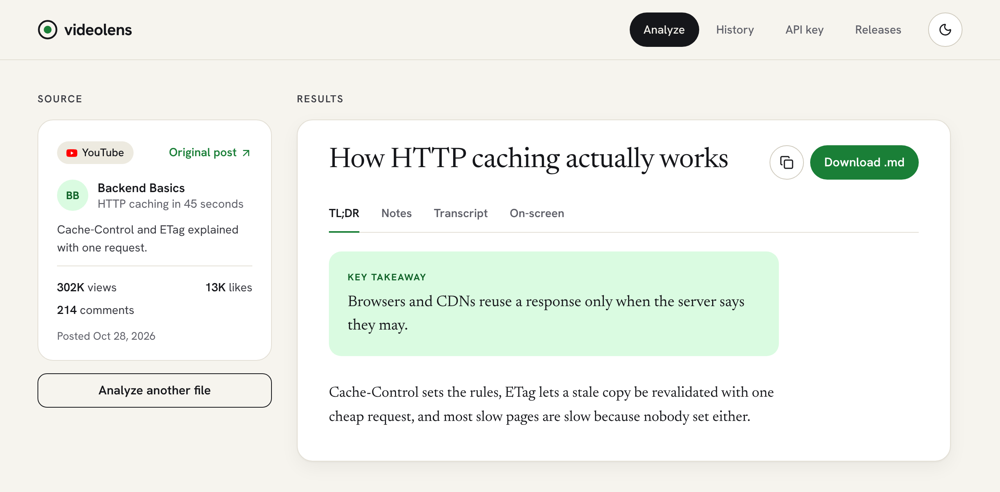
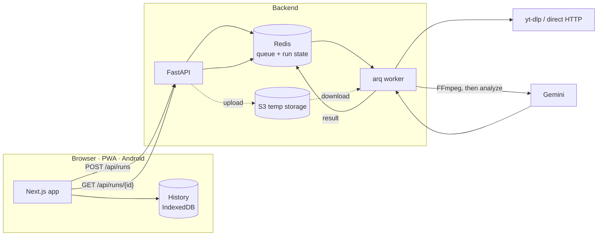
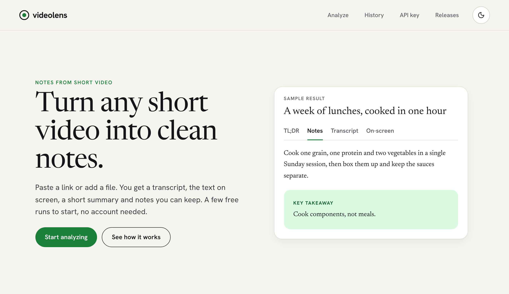
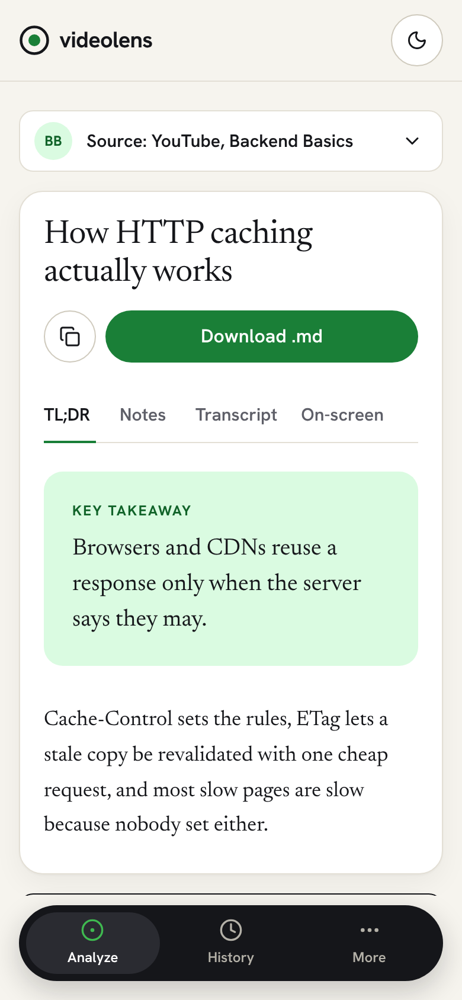

# VideoLens AI

[](https://github.com/thisisgaganbirru/videolens/actions/workflows/production-environment.yml)
[](https://github.com/thisisgaganbirru/videolens/releases/latest)
[](LICENSE)

Upload short audio/video or paste a public media URL and get a transcript,
on-screen text extraction, a natural language summary, and formatted markdown
notes — powered by Gemini's multimodal video understanding, so it captures
speech, on-screen text, code, UI, and charts, not just audio.

Users can upload MP3, MP4, or MOV files, or submit a public URL from a site
yt-dlp supports, including many Instagram, TikTok, and YouTube URLs. Media is
limited to 3 minutes and 200 MB. Private, expired, region-blocked, or login-only
URLs may not be downloadable; when a platform blocks the video but still serves
its subtitles, the run completes from the caption track and says so.

It runs as a web app, an installable PWA, and an Android app (Capacitor), all
against the same backend.

<p align="center">
  
</p>

## How it works




1. A fresh anonymous client calls `GET /api/free-runs` once for a signed
   device token and today's free-run allowance.
2. The frontend sends a media file or public URL to `POST /api/runs`, which
   returns `{ run_id, status: "queued" }` after validating an uploaded file.
3. For URLs the backend downloads the media (yt-dlp, then a plain HTTP fetch
   as fallback), then validates and normalizes with FFmpeg, uploads to
   Gemini, and runs the analysis. A thumbnail is made server side alongside.
4. The frontend polls `GET /api/runs/{run_id}` until `complete` or `failed`,
   and stores every state in the browser's IndexedDB. History lives in the
   browser; the server forgets a run an hour after delivering it.
5. The result contains `title`, `summary`, `transcript` (with timestamped
   segments), `screen_text` (with segments), and `markdown`.

Local development runs entirely in-process. Production uses Redis, an arq
worker, and S3-compatible temporary storage. Uploaded and downloaded files are
deleted after every run, success or failure.

## Project layout

```
backend/             FastAPI API, worker, FFmpeg, Gemini, Redis/S3 adapters
frontend/            Next.js PWA and Capacitor source
frontend/android/    Android API 36 native project
docs/                Per-feature reference docs (index in docs/README.md)
scripts/             workspace.ps1, the Docker Compose local-workspace lifecycle
.github/             CI lanes, composite actions, Dependabot
VideoLens-Security-Assessment-2026-11-07.xlsx   Security assessment tracker
```

Both apps follow the same clean-architecture layering; `backend/ARCHITECTURE.md`
and `frontend/ARCHITECTURE.md` are the codemaps. `CLAUDE.md` holds the rules
for anyone (or any agent) changing the code.

## Running locally

### Backend

```bash
cd backend
python -m venv .venv && source .venv/bin/activate
pip install -r requirements.txt
cp .env.example .env   # fill in GEMINI_API_KEY
uvicorn app.main:app --reload
```

Python 3.13 (`.python-version`). Needs `ffmpeg` and `ffprobe` on `PATH`, or
`FFMPEG_LOCATION` pointing at the directory holding both; the backend checks
at startup. Login-gated links (some Instagram URLs) need cookies: set
`YTDLP_COOKIES_FROM_BROWSER=chrome` locally, or mount a Netscape-format cookie
file and set `YTDLP_COOKIES_FILE` when deployed. Configure only one. Never
commit a cookie file.

### Frontend

```bash
cd frontend
npm install
cp .env.example .env.local
npm run dev            # http://localhost:3005, allowed by the backend's default ALLOWED_ORIGINS
```

Node 24 (`.nvmrc`).

### With Docker Compose

```powershell
cp backend/.env.example backend/.env   # fill in GEMINI_API_KEY
.\scripts\workspace.ps1 up             # or: docker compose up --build
```

Starts the frontend (`:3000`), API (`:8000`), worker, Redis, and MinIO
(console `:9001`), all on loopback. This is the local workspace only; it is
never a deployment manifest. See `docs/container-workflows.md`.

## API

- `POST /api/runs` — multipart with exactly one of `file` (MP3/MP4/MOV) or
  `url`, plus `accept_terms=true`. Returns `202 { run_id, status }`. Needs
  `X-Client-ID` (scopes which runs a browser can see, not quota). Checked
  before any download or FFmpeg work, in this order:
  - per source IP, or per token when signed in (`RATE_LIMIT_PER_HOUR`,
    default 20): `429` with `Retry-After`. The IP is taken from the
    `X-Forwarded-For` entry the deployment's own proxy wrote
    (`TRUSTED_PROXY_HOPS`), so a forged header cannot pick a fresh bucket;
  - without a Gemini key of their own, callers need `X-Device-Token` and get
    `FREE_RUNS_PER_DEVICE` (3) runs per UTC day, `FREE_RUNS_PER_IP` (10) as a
    backstop: `401 {"code": "device_token_invalid"}` or
    `402 {"code": "free_runs_used", "scope": "device", "period": "day", "limit", "used"}`.
    A signed-in account (bearer JWT or API key) instead gets
    `FREE_RUNS_PER_ACCOUNT_DAILY` (10) runs per UTC day, no device token
    needed: `402 {"code": "free_runs_used", "scope": "account", "period": "day", "limit", "used"}`;
  - `DAILY_RUN_CAP` (200) across all callers per UTC day: `503`.
  An `X-Gemini-Api-Key` header exempts the run from the last two. A paid
  account (when billing is configured) takes `PAID_RUNS_PER_DAY` (30)
  included runs a UTC day from its account counter, then each further run is
  admitted and billed once it completes, up to `PAID_EXTRA_RUNS_MONTHLY_CAP`
  (`402 {"code": "extra_runs_cap", "limit"}`); paid runs skip the daily cap
  and get the paid media limits with or without a key.
  Media limits depend on the caller: signed in (bearer JWT or account API
  key) AND sending `X-Gemini-Api-Key` allows 10 minutes / 500 MB
  (`SIGNED_IN_BYOK_MAX_*`); everyone else keeps 3 minutes / 200 MB
  (`MAX_DURATION_SECONDS`, `MAX_FILE_SIZE_MB`). Over-limit refusals keep
  their status and `{detail}` shape; the sentence may end with a hint such as
  "Sign in and add your own Gemini key for videos up to 10:00." One run above
  the standard limits may be in flight per account; a second is
  `429 {"code": "long_run_in_progress"}` (a link only learns its length in the
  worker, so there the same sentence arrives as the run's `error`).
- `GET /api/limits` — `{ standard: { max_duration_seconds, max_file_size_mb },
  signed_in_byok: { ... }, paid: { ... } }` from settings. No auth, read-rate-limited,
  `Cache-Control: public, max-age=300`.
- `GET /api/free-runs` — `{ device_token, enabled, scope, period, limit, used,
  remaining, resets_at }`; issues a token when the sent one is missing or
  forged. Never spends a run. `scope` is `device`, or `account` (today's
  account runs) with a valid bearer; an invalid bearer is `401`. `period`
  is `day` (device, free account and, since 2026-11-14, the paid plan;
  `resets_at` = next UTC midnight); `month` stays in the contract but no
  counter uses it now.
  Signed in, also `plan` (`free` | `paid`) and `overage` (true on the paid
  plan: runs past `limit` are billed, not refused).
- `GET /api/billing` — the signed-in caller's plan: `{"enabled": false}`
  with billing off, else `{ enabled, plan, status, interval,
  current_period_end, cancel_at_period_end, runs: { limit, used, period },
  extra_runs, prices: { month, year, extra_run } }` (amounts in cents, read
  from Stripe; any may be `null`). `extra_runs` is `{ used, limit, period:
  "month", resets_at }` on the paid plan (billed extra runs this UTC month,
  `limit` null when the cap is off) and `null` otherwise. `POST /api/billing/checkout` `{ interval: "month" | "year" }`
  and `POST /api/billing/portal` return `{ url }` for Stripe-hosted Checkout
  or the Customer Portal (signed-in person only; `409 already_subscribed`,
  `404 no_billing_account`). `POST /api/billing/webhook` is Stripe's,
  verified by signature. `docs/backend/billing.md`.
- `GET /api/runs/{run_id}` — `{ run_id, status, stage, result,
  source_metadata, completeness, error, source_kind, platform,
  duration_seconds, thumbnail, width, height, orientation }`. `status` is
  `queued` | `processing` | `complete` | `failed`; `stage` while processing is
  `downloading` | `normalizing` | `uploading_to_gemini` | `analyzing` |
  `analyzing_captions`; `completeness` is `full` | `captions_only`.
- `GET /api/runs` — the caller's runs still on the server, newest first,
  capped at 20.
- `GET /api/capabilities` — which parts of this deployment work right now,
  always `200`. `GET /api/releases` — the app's release index, read from
  GitHub server-side. `GET /api/health`, `GET /api/readiness`. The read
  endpoints share a looser per-IP limit (`READ_RATE_LIMIT_PER_MINUTE`, 120),
  and every response carries security headers (`docs/backend/security-headers.md`).

Run access is owner-bound. Optional OIDC bearer tokens are verified when
`AUTH_*` is configured; anonymous access stays on unless
`ALLOW_ANONYMOUS=false`. Full contracts: `docs/backend/`.

### Bring your own key

The "API key" tab lets someone paste their own Gemini key (from
[Google AI Studio](https://aistudio.google.com/apikey)). It is stored only in
the browser's `localStorage`, sent as `X-Gemini-Api-Key`, never written to run
storage or logs, and in distributed mode travels to the worker through a
single-use Redis entry rather than as a job argument. BYOK runs skip the daily
cap and the free-run allowance but keep the per-IP rate limit, since FFmpeg
and worker capacity are spent either way. See `docs/backend/byok.md`.

## Use from an AI agent

An MCP server (`mcp/`) lets terminal AI agents (Claude Code, Cursor, Codex,
Antigravity, any MCP client) call VideoLens directly with two tools,
`analyze_video` and `list_recent_runs`. It requires the caller's own Gemini
key via the agent's MCP config. It is parked on the unmerged
`feature/mcp-server` branch until the frontend work settles and is not on npm;
that branch's `mcp/README.md` covers building it.

## Configuration

See `backend/.env.example` and `frontend/.env.example`. Every backend setting
is documented there; the ones to set before going live are `GEMINI_API_KEY`,
`ALLOWED_ORIGINS` (the API refuses to start in distributed mode with `*`),
`DEVICE_TOKEN_SECRET`, `TRUSTED_PROXY_HOPS` (2 on Railway, the default), `REDIS_URL`, the
`S3_*` variables, and `GITHUB_TOKEN` for the Releases tab. The frontend has one,
`NEXT_PUBLIC_API_BASE_URL`, inlined at build time. Set a hard budget alert on
the Gemini key itself; it is the only limit enforced outside this code.

## PWA and Android

<table>
  <tr>
    <td width="66%"></td>
    <td width="34%"></td>
  </tr>
  <tr>
    <td align="center"><sub>Browser tab</sub></td>
    <td align="center"><sub>Installed app (PWA or Android)</sub></td>
  </tr>
</table>

The frontend is an installable PWA with an offline fallback, launcher icons,
and share-target support; the service worker never caches API responses or
media. The installed app gets a phone-style shell with a bottom tab bar; a
browser tab gets a top nav and footer.

```bash
cd frontend
npm run android:sync
cd android && ./gradlew assembleDebug testDebugUnitTest
```

The Android app targets API 36, accepts shared links, uses the native media
picker, follows the system theme and font scale, and shares or saves results
through the system share sheet. Every push to `main` publishes an APK
(release-signed once the CI signing secrets exist, debug-signed until then)
as a GitHub Release
(`v<version>-build<code>`); every PR into `dev` keeps a debug-signed,
`.dev`-suffixed test APK as a 14-day artifact. The installed app checks for a
newer release on launch. Versioning, signing and the release pipeline are in
`docs/container-workflows.md`; the update check in
`docs/frontend/android-update-check.md`. A Play Store `.aab` still needs an
operator-owned signing key and Play Console setup.

## Deployment

One Railway project, two environments: `dev` tracks the `dev` branch,
`production` tracks `main`, each running the API (`backend/railway.json`),
worker (`backend/railway.worker.json`), frontend (`frontend/railway.json`),
Redis, and a bucket. Railway builds from source and holds a production deploy
until the commit's CI is green. GitHub Actions runs three lanes: PRs into
`dev` check what they touch with an advisory scan; the promotion into `main`
runs everything with the scan enforced; the merge publishes images and the
Android release. `DEPLOYMENT.md` has the variables and release checklist,
`docs/railway-environments.md` the deploy triggers, `docs/container-workflows.md`
the workflows.

## Contributing

See `CONTRIBUTING.md`. Branch from `dev`, run the checks CI runs, keep the
layering, update the `docs/` reference for anything you touch, plain commit
messages with no attribution trailers.

## License

[GNU AGPL-3.0](LICENSE). If you run a modified version of this project as a
network service, you must make your modified source available to that
service's users — see the license text for the exact terms.
